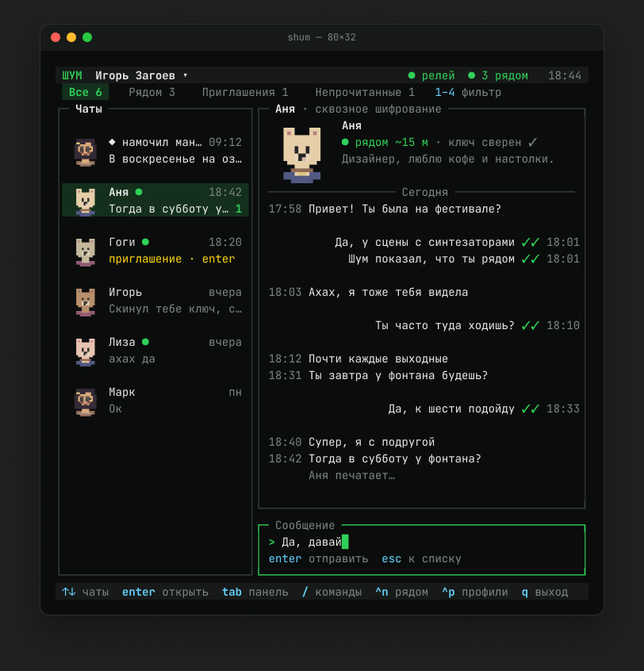
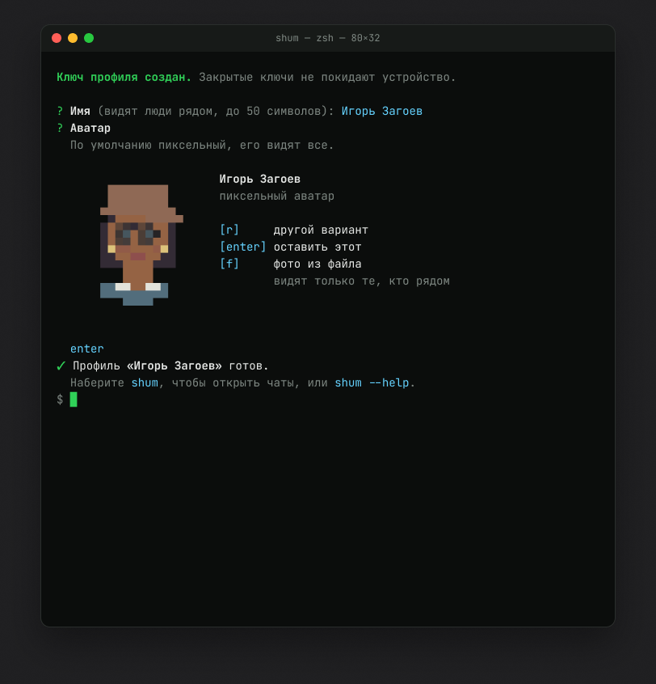

<p align="center">
  
</p>

<h1 align="center">Shum для терминала</h1>

<p align="center">
  Чаты, приглашения, QR, профили и зашифрованная история в терминале.<br>
  Сообщения идут по Bluetooth или через релеи Nostr.
</p>

<p align="center">
  <a href="https://github.com/hiTechTeam/Shum-CLI/releases/latest"></a>
  <a href="https://github.com/hiTechTeam/Shum-CLI/releases"></a>
  <a href="LICENSE"></a>
</p>

<p align="center">
  <a href="README.md">English</a> · Русский
</p>

<p align="center">
  
  
</p>

Клиент Shum для терминала на [Shum Core](https://github.com/hiTechTeam/Shum-Core). Чаты, приглашения, QR, профили, зашифрованная история и фоновая служба. Сообщения передаются по Bluetooth или через Nostr.

## Установка

У Shum CLI две линии версий, их показывают бейджи выше: **macOS и Linux** (macOS 15+ на Apple Silicon, Linux x64 и ARM64) и **Windows** (10 и 11, x64 и ARM64). Обе пока превью.

```sh
brew install hitechteam/shum/shum
shum
```

Первый запуск предлагает создать профиль. Shum обновляется сам: его фоновая служба раз в сутки проверяет GitHub и ставит новую версию тем же способом, каким Shum был установлен. Обновить сразу или выключить обновление в фоне:

```sh
shum update
shum update --auto off
```

С Homebrew можно обновить и вручную:

```sh
brew update
brew upgrade shum
```

Без Homebrew установка и обновление выполняются одной командой:

```sh
curl -fsSL https://raw.githubusercontent.com/hiTechTeam/Shum-CLI/main/install.sh | sh
```

Скрипт проверяет SHA-256 и подпись, устанавливает бандл в `~/.local/share/shum` и ссылку `~/.local/bin/shum`. При необходимости показывает подсказку PATH, файлы оболочки не меняет. Установка рядом с Homebrew отклоняется.

В [загрузках](https://github.com/hiTechTeam/Shum-CLI/releases) есть архив для Apple Silicon и установщик macOS. Intel Mac не поддерживается с 0.1.21. Сертификат самоподписанный, не Apple Developer ID; нотарификации нет. Gatekeeper на чистой учётной записи пока не проверен.

## Использование

```sh
shum chats
shum profile
shum qr
shum contacts
shum add 'shum://c4/<signed-profile>'
shum add --image ~/Desktop/invite.png
shum invite 'CONTACT_ID'
shum open 'CONTACT_ID'
shum send 'CONTACT_ID' "Привет"
shum status
```

Замените CONTACT_ID на ID из `shum contacts`. Команды контактов принимают Shum ID, уникальный префикс от восьми символов или полный публичный Nostr-ключ. Имена служат для отображения. Полные карточки и QR добавляются офлайн; получение новой карточки по сетевому ID требует ответа собеседника.

В открытом чате `/invite` приглашает его собеседника. Отправка приглашения и ответ сохраняются в переписке. Получатель выбирает `/accept` или `/decline`; после отказа можно передумать и выполнить `/accept`. `/qr` показывает вашу карточку. `/help` открывает справку, Ctrl+Q закрывает интерфейс. В списке чатов видны непрочитанные сообщения и набор текста. Terminal рисует аватары цветом ячеек, Warp использует PNG.

В открытом чате нажмите **Ctrl+R** или введите `/react` и нажмите Enter. Выберите сообщение стрелками ↑/↓, нажмите Enter, затем выберите пиксельную реакцию стрелками и подтвердите Enter. Esc возвращает назад или отменяет выбор. Повторный выбор своей реакции снимает её. В меню и переписке те же восемь пиксельных иконок, что и в iOS. Под сообщением одинаковая реакция отображается одной иконкой с двумя именами через `/`; у разных реакций своя иконка и имя автора. В Warp используются компактные PNG. Аватары и реакции вне меню остаются видимыми. Открытие выбора через Ctrl+R сохраняет черновик.

После выхода служба продолжает работать. `shum daemon --stop` останавливает её; `shum daemon --install` включает запуск при входе. После обновления следующая команда CLI заменяет старую службу, сохраняя очередь. Разрешите доступ Shum к Bluetooth в запросе macOS.

Локальные профили выбираются по полному ID из `shum profile list`: `shum profile use 'PROFILE_ID'`, `shum -p 'PROFILE_ID' chats` или `shum profile delete 'PROFILE_ID'`. При удалении показываются имя и ID; ввод имени только подтверждает операцию, а не выбирает профиль.

Регистрация показывает анимацию сборки ключа, плавно заполняет шкалу и отмечает галочками создание ключей, шифрование, защищённое хранилище и проверку, затем спрашивает имя. После этого первый аватар вычисляется из открытого ключа подписи, как на iPhone. Ключи остаются в памяти до подтверждения аватара; для подготовки используется временное зашифрованное хранилище. Имена профилей могут совпадать, а ID, ключи и переписка независимы.

## Язык

В CLI те же десять языков, что и в iOS: русский, английский, испанский, китайский упрощённый, хинди, французский, японский, португальский Бразилии, арабский и корейский.

```sh
shum language ru        # сохранить язык для этого каталога данных
shum language system    # снова использовать системный язык
shum --lang en          # выбрать язык только для этого запуска
shum language           # показать текущий язык и доступные коды
```

В чате `/language ru` сразу переключает и сохраняет язык, `/language` или Ctrl+L открывает меню языков. Выбор стрелками ↑/↓, Enter подтверждает, Esc закрывает. Аватары и реакции вне меню остаются видимыми. Коды: `ru`, `en`, `es`, `zh-Hans`, `hi`, `fr`, `ja`, `pt-BR`, `ar`, `ko`, `system`.

Приоритет: `--lang`, `SHUM_LANG`, сохранённая настройка, язык системы. Системный язык определяется по `LC_ALL`, затем `LC_MESSAGES`, затем `LANG`; если они не заданы, используются предпочитаемые языки macOS. Для неподдерживаемого языка и `C`/`POSIX` выбирается английский. Китайские локали используют упрощённый китайский, португальские локали используют вариант Бразилии. Настройка хранится в `cli-settings.json` в каталоге данных, профиль для неё не создаётся. Команды, ID, поля JSON и сообщения не переводятся. Диагностика системы и зависимостей может оставаться на исходном языке. Отрисовка арабского письма зависит от терминала; порядок колонок интерфейса сохраняется.

### Windows

У версии для Windows своя нумерация, она начинается с 0.1.0. Windows 10 и 11, x64 и ARM64. Установка и обновление в PowerShell:

```powershell
irm https://raw.githubusercontent.com/hiTechTeam/Shum-CLI/main/install.ps1 | iex
```

Скрипт выбирает сборку под процессор, проверяет SHA-256, ставит `shum.exe` в `%LOCALAPPDATA%\Programs\Shum` и добавляет каталог в PATH пользователя. Сборки делаются на macOS кросс-компиляцией (`scripts/package_windows.sh`) и не подписаны. На настоящем Windows они ещё не запускались. Bluetooth пока только находит устройства рядом: другие устройства компьютер с Windows не видят, а без Bluetooth переписка идёт через интернет.

### Linux (превью)

У Linux та же нумерация, что у macOS. x64 и ARM64, glibc 2.35 и новее (Ubuntu 22.04, Debian 12 и новее). Установка и обновление без sudo:

```sh
curl -fsSL https://raw.githubusercontent.com/hiTechTeam/Shum-CLI/main/install-linux.sh | sh
```

Скрипт выбирает сборку под процессор, проверяет SHA-256, ставит `shum` в `~/.local/lib/shum-cli` и делает ссылку `~/.local/bin/shum`. Профили лежат в `~/.local/share/shum`, ключи в хранилище секретов системы (GNOME Keyring или KWallet), службы работают как юниты `systemd --user`. Bluetooth через BlueZ. Сборки делаются в Docker на macOS (`scripts/package_linux.sh`) и не подписаны.

## Резервная копия

Копия переносит профиль на другой компьютер или возвращает его. Файл защищён паролем не короче 10 символов; храните файл и пароль отдельно. Формат общий для всех клиентов Shum (раздел 13 протокола), поэтому копию восстановят и другие клиенты.

```sh
shum backup create ~/Shum-backup.shumbackup
shum backup restore ~/Shum-backup.shumbackup
```

Восстановление создаёт новый профиль с тем же Shum ID. Если такой профиль уже есть на этом компьютере, добавьте `--replace`. Для скриптов `--password-stdin` читает пароль из первой строки стандартного ввода. Копия нужна, чтобы перенести профиль, а не чтобы пользоваться им на двух устройствах сразу.

## Удаление

Для Homebrew:

```sh
shum daemon --uninstall
brew uninstall shum
```

Для установки скриптом:

```sh
curl -fsSL https://raw.githubusercontent.com/hiTechTeam/Shum-CLI/main/install.sh | sh -s -- --uninstall
```

Для Windows:

```powershell
& ([scriptblock]::Create((irm https://raw.githubusercontent.com/hiTechTeam/Shum-CLI/main/install.ps1))) -Uninstall
```

Для Linux:

```sh
curl -fsSL https://raw.githubusercontent.com/hiTechTeam/Shum-CLI/main/install-linux.sh | sh -s -- --uninstall
```

Данные остаются в `~/Library/Application Support/org.Shum.Shum` или вашем `--data-dir`; ключи могут храниться в Keychain.

Для безвозвратного удаления всех профилей, ключей (включая Keychain), переписки и кэша служб:

```sh
shum daemon --uninstall --purge
brew uninstall shum
```

Подтвердите удаление словом `DELETE`. Для скриптов добавьте `--confirm DELETE`. Доступно с версии 0.1.7. Без `--data-dir` учитываются стандартный каталог и другие каталоги данных, зарегистрированные в LaunchAgents Shum. С `--data-dir` удаляются только данные Shum в указанном каталоге. Посторонние файлы сохраняются, команда сообщает об этом. Установленное приложение отдельно удаляет пакетный менеджер или скрипт установки.

В версии 0.1.6 перед удалением служб и пакета удалите каждый профиль командой `shum profile delete 'PROFILE_ID'`. Она также удаляет ключи профиля из Keychain. После этого оставшийся каталог данных можно удалить вручную.

Если бинарник уже удалён, выгрузите каждый LaunchAgent Shum и удалите его plist:

```sh
launchctl bootout "gui/$(id -u)" "$HOME/Library/LaunchAgents/org.shum.cli.<profile-id>.plist"
rm "$HOME/Library/LaunchAgents/org.shum.cli.<profile-id>.plist"
```

Подставьте ID из имени файла. `KeepAlive=false` предотвращает цикл перезапуска без бинарника.

## Разработка и состояние

```sh
python3 scripts/check_locales.py
cargo test --locked
cargo clippy --locked --all-targets -- -D warnings
cargo fmt --all -- --check
```

CLI и Core имеют отдельные репозитории и выпуски. Все зависимости ядра закреплены одной Git-ревизией. CI запускается вручную. Один профиль работает сразу на нескольких устройствах: iPhone, приложение для компьютера, Shum Web и другие компьютеры. Сборки для Windows и Linux пока в превью.

Что изменилось в каждой версии, смотрите в [Releases](https://github.com/hiTechTeam/Shum-CLI/releases).

[getshum.tech](https://getshum.tech) · [iPhone](https://github.com/hiTechTeam/Shum-iOS) · [Компьютер и веб](https://github.com/hiTechTeam/Shum-App) · [Проверка выпуска](docs/release-verification-0.1.8-r1.md) · [Распространение](docs/distribution.md) · [Состояние протокола](docs/protocol-status.md) · [Подробная инструкция](docs/cli-guide.ru.md) · [Issues](https://github.com/hiTechTeam/Shum-CLI/issues)

## Лицензия

[MIT](LICENSE), copyright 2026 hiTechTeam.
